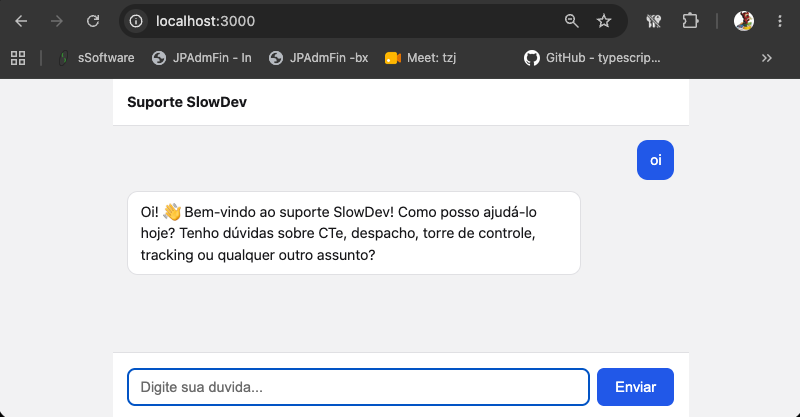

# POC - Agente manual com RAG, MCP e Tools

O objetivo desse projeto é apenas ser uma prova de conceito para ver tudo funcionando de maneira simples, **sem preocupação com segurança e padrões**. Não use em produção.



## O que este projeto demonstra

- **Loop de tool use manual** com a API da Anthropic, sem framework de agentes
- **RAG** com Postgres + pgvector e embeddings gerados localmente (transformers.js)
- **Servidor MCP próprio** via HTTP, autenticado por token, consumido pelo agente
- **Ferramentas locais e remotas juntas**: o agente executa a busca local e delega o resto ao MCP
- **Confirmação do usuário** antes de uma ação com efeito colateral (abrir chamado)
- **Docker Compose** subindo banco, servidor MCP e agente com um comando

## Projetos

### suporte-mcp

Servidor MCP comunicando via HTTP (`http://localhost:3333/mcp`, autenticado por token Bearer) com duas ferramentas:

- `consultar_cte` — consulta o status de um CT-e
- `abrir_chamado` — abre um chamado de suporte

Os dados ficam em memória, apenas para demonstração.

### suporte-poc

Loop de agente **manual** (sem framework de agentes) em que a API da Anthropic é usada como cérebro do agente. Ele:

- consome as ferramentas do servidor MCP;
- usa uma ferramenta local, `buscar_documentacao`, que faz a busca no banco vetorial (Postgres + pgvector) para funcionar o RAG sobre os arquivos de `docs/`;
- exige a confirmação do usuário antes de abrir um chamado.

Pode ser usado pela interface web (http://localhost:3000) ou pelo terminal.

## Estrutura

```
.
├── docker-compose.yml           # sobe tudo: db + mcp + chat
├── docker-compose/
│   └── docker-compose-db/       # sobe apenas o banco (para rodar local)
├── suporte-mcp/                 # servidor MCP
└── suporte-poc/                 # agente, RAG, API e interface web
```

## Como rodar

### Com Docker (tudo junto)

1. Suba tudo:

   ```sh
   ANTHROPIC_API_KEY={INFORME_A_CHAVE_DA_API_AQUI} MCP_TOKEN={INFORME_O_TOKEN_DO_MCP_AQUI} docker compose up -d --build
   ```

3. Acesse http://localhost:3000.

### Local (sem Docker para as aplicações)

1. Suba apenas o banco:

   ```sh
   docker compose -f docker-compose/docker-compose-db/docker-compose.yml up -d
   ```

2. Em cada projeto, copie `.env-modelo` para `.env` e preencha os valores (o `MCP_TOKEN` deve ser igual nos dois).
3. Suba o servidor MCP:

   ```sh
   cd suporte-mcp && npm install && npm start
   ```

4. Em outro terminal, suba o agente:

   ```sh
   cd suporte-poc && npm install
   npm run start-api     # interface web em http://localhost:3000
   npm run start-agent   # ou: conversa pelo terminal
   ```

Os dois comandos do `suporte-poc` criam o schema (se ainda não existir) e reindexam os documentos de `docs/` antes de iniciar.

## Variáveis de ambiente

| Projeto     | Variável            | Descrição                                       |
| ----------- | ------------------- | ----------------------------------------------- |
| suporte-mcp | `MCP_TOKEN`         | Token exigido pelo servidor MCP                 |
| suporte-mcp | `MCP_PORTA`         | Porta do servidor MCP (padrão `3333`)           |
| suporte-poc | `ANTHROPIC_API_KEY` | Chave da API da Anthropic                       |
| suporte-poc | `ANTHROPIC_MODEL`   | Modelo usado pelo agente (`claude-haiku-4-5`)   |
| suporte-poc | `DATABASE_URL`      | Conexão com o Postgres                          |
| suporte-poc | `API_PORT`          | Porta da API web (padrão `3000`)                |
| suporte-poc | `MCP_URL`           | Endereço do servidor MCP                        |
| suporte-poc | `MCP_TOKEN`         | Mesmo token configurado no suporte-mcp          |

## Próximos passos

- Garantir a confirmação do `abrir_chamado` no código do agente, e não apenas pelo prompt
- Testes automatizados
- Persistir as sessões de conversa (hoje ficam em memória)

## Licença

[MIT](LICENSE)
